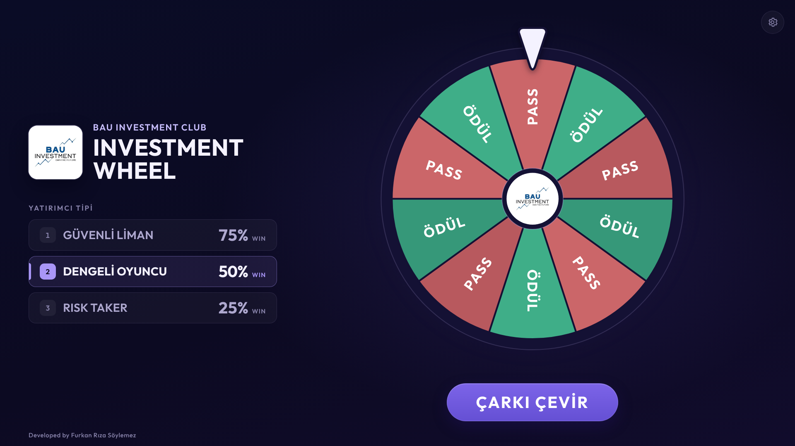

# BAU Investment Club — Investment Wheel



## Overview

Investment Wheel is a single-page web app built for **BAU Investment Club Week**. It runs on a laptop connected to a projector or large screen (designed for 1920×1080 and readable from 5–10 m).

A participant picks an investor profile, the wheel spins, and the result is shown as **ÖDÜL** (reward) or **PASS**. Riskier profiles have a lower chance of a reward. The point is to make risk and probability tangible in a few seconds.

The app is frontend-only. There is no backend, database, login or tracking, and every visitor's wheel runs independently in their own browser.

## Features

- Investor profile selection (mouse or keys `1` / `2` / `3`)
- Probability-based wheel: segment sizes match the configured probabilities
- Configurable win/loss probabilities per profile
- Smooth wheel animation with a soft start and long deceleration
- ÖDÜL / PASS result card that returns to idle automatically
- Optional sound effects, generated in the browser
- Fullscreen mode
- Local persistence of settings
- Works offline once loaded; fonts, logo and sounds are bundled
- Responsive layout from 1280×720 up to 4K, plus a single-column layout for narrow or portrait windows

## Investor Profiles

| Profile        | Default Reward Probability | Default Pass Probability |
| -------------- | -------------------------: | -----------------------: |
| GÜVENLİ LİMAN  |                        75% |                      25% |
| DENGELİ OYUNCU |                        50% |                      50% |
| RISK TAKER     |                        25% |                      75% |

Each profile also has a fixed number of wheel segments (8, 10 and 12). The segment count only changes how the reward and pass areas are split; their total size always equals the probability.

## How It Works

1. The user selects an investor profile.
2. The profile's reward probability is read from the single probability state.
3. Before the wheel moves, the result is decided: `Math.random() < probability / 100` means ÖDÜL, otherwise PASS.
4. One of the wheel segments with that result is picked at random.
5. The target rotation is calculated so that the center of that segment stops under the pointer, after 5 to 8 full turns.
6. The wheel rotates to that angle with a CSS transform (about 6.5 seconds, GPU-accelerated, no per-frame JavaScript).
7. The pointer lands on the chosen segment.
8. The result card is shown.
9. After about 5 seconds the app returns to the idle state and the next spin is allowed.

> The wheel animation does not decide the result. The result is decided first, and the animation only shows it.

While the wheel is spinning and the result is on screen, the spin button, profile selection, keyboard shortcuts and probability sliders are locked, so a double click can never start a second spin or change the odds mid-spin.

## Probability System

There is one source of truth for probabilities. The value shown in the settings panel, the wheel geometry and the result engine all read the same number:

- **UI:** the slider and the `KAZANIR %X / KAYBEDER %Y` labels
- **Wheel geometry:** reward segments cover exactly `360° × X / 100` of the wheel
- **Result engine:** `Math.random() < X / 100`

The pass probability is always `100 − X`. At 0% the wheel can never land on ÖDÜL, and at 100% it can never land on PASS.

## Settings

Open the panel with the gear icon in the top-right corner (close it with `Esc`).

- **Probabilities:** one slider per profile; the wheel updates live
- **Reset to defaults:** "Varsayılanlara Dön" asks for confirmation, then restores 75 / 50 / 25
- **Sound:** on by default
- **Fullscreen:** enter or exit fullscreen

## Persistence

Probabilities and the sound setting are stored in the browser's `localStorage`:

| Key                             | Value                                                 |
| ------------------------------- | ----------------------------------------------------- |
| `investment-wheel:probabilities` | `{"safe-harbor":75,"balanced":50,"risk-taker":25}` |
| `investment-wheel:sound`        | `on` or `off`                                         |

Stored values are validated on load. Anything invalid (text, `null`, negative, above 100, broken JSON, wrong type) falls back to the default for that profile. Spin and result state are never stored, so a refresh always starts from a clean idle screen.

## Tech Stack

- React 19
- TypeScript 5.9 (strict)
- Vite 8
- CSS Modules with a small set of design tokens
- Web Audio API for sound (no audio files)
- [Outfit](https://fontsource.org/fonts/outfit) variable font, bundled via `@fontsource-variable/outfit`
- Browser `localStorage`

## Project Structure

```text
src/
  App.tsx               layout, shared state and keyboard shortcuts
  components/
    Header/             club logo and title
    InvestorTypeSelector/
    Wheel/              SVG wheel (static frame, rotating segments, pointer)
    SpinButton/
    ResultReveal/       ÖDÜL / PASS card
    Settings/           settings panel, probability sliders
  config/
    investorTypes.ts    profiles and default probabilities
    settingsStorage.ts  localStorage load / save / validation
    brand.ts            club name, title, credit, logo
  wheel/
    spin.ts             result engine and rotation math
    segments.ts         wheel geometry from a probability
    useWheelSpin.ts     spin state machine (idle → spinning → revealing → showingResult → idle)
    resultTiming.ts     result timing
  sound/                Web Audio sounds
  styles/               design tokens and global styles
  assets/brand/         club logo
scripts/
  simulate.ts           probability simulation
public/
  favicon.png
```

## Installation

Requires Node.js 22.12 or newer (Node 20.19+ also works for everything except `npm run simulate`, which needs 22.6+).

```bash
npm install
npm run dev
```

The dev server runs at http://localhost:5173.

## Build

```bash
npm run build
npm run preview
```

`npm run build` type-checks the project and writes the production build to `dist/`. `npm run preview` serves that build at http://localhost:4173.

## Simulation

```bash
npm run simulate
```

Runs the real result engine 10,000 times per scenario (pass a number to change it, e.g. `npm run simulate -- 100000`). It checks:

- the default profiles (75%, 50%, 25%) and custom values 0, 10, 25, 50, 75, 90 and 100% with 8, 10 and 12 segments
- that the simulated reward rate is close to the target, with 0% never rewarding and 100% always rewarding
- that the pointer always lands on the selected segment
- that the reward area on the wheel equals the probability
- that every spin makes between 5 and 8 turns

## Deployment

The app is a static site, so it deploys to Vercel with no extra configuration.

1. Push the repository to GitHub.
2. In Vercel, choose **Add New → Project** and import the repository.
3. Vercel detects the framework as **Vite**.
4. Build command: `npm run build`.
5. Output directory: `dist`.
6. Deploy.

No environment variables, serverless functions or rewrites are needed: there is one page and no router. Each visitor downloads the same static files and runs their own wheel, so many people can use it at the same time without affecting each other.

## Event Usage

1. On the event laptop, run `npm run build` and `npm run preview` (or open the Vercel URL).
2. Open the settings panel, check the probabilities and sound, then choose **Tam Ekrana Geç** (fullscreen).
3. For each participant: pick a profile (click or press `1` / `2` / `3`), press **ÇARKI ÇEVİR**, and let the result card disappear on its own.

Once the page has loaded, the app keeps working if the internet drops. Running it locally with `npm run preview` means it does not need the internet at all, even after a refresh.

## Design Philosophy

A modern, fintech-inspired dark interface designed for large-screen projection. The wheel is the hero of the screen; everything else stays quiet. Motion is calm and purposeful, green and red are used only for results, and there are no particles, flashing or casino effects.

## License / Credits

Developed by **Furkan Rıza Söylemez** for **BAU Investment Club** and BAU Investment Club Week.

The club logo belongs to BAU Investment Club. The Outfit font is licensed under the SIL Open Font License.
